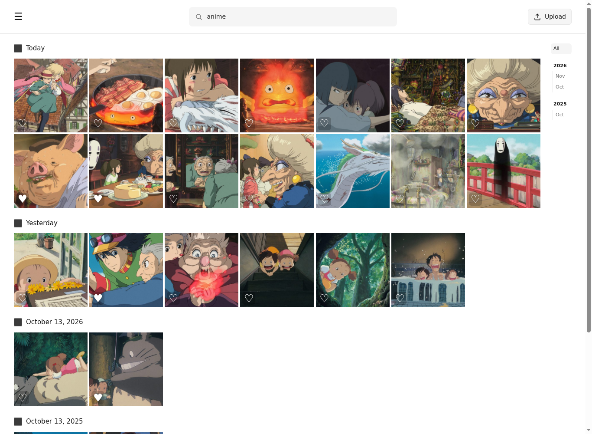
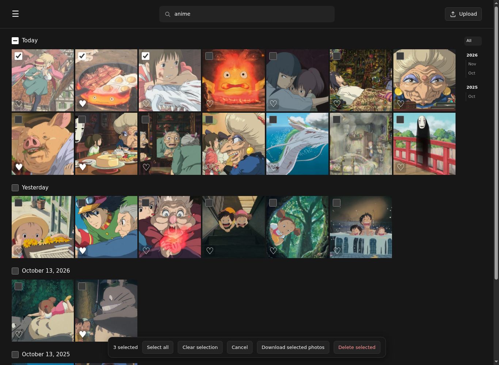
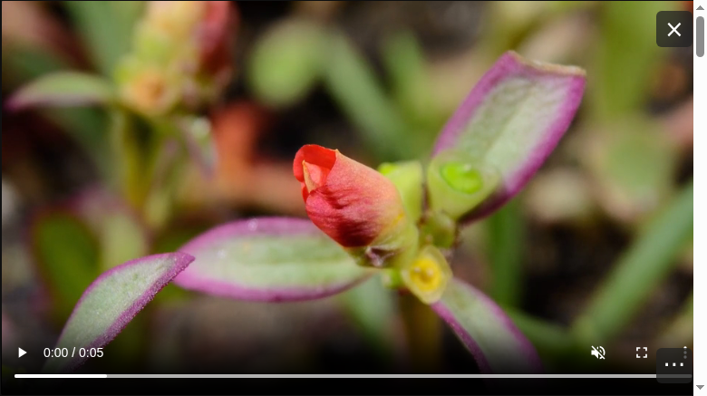
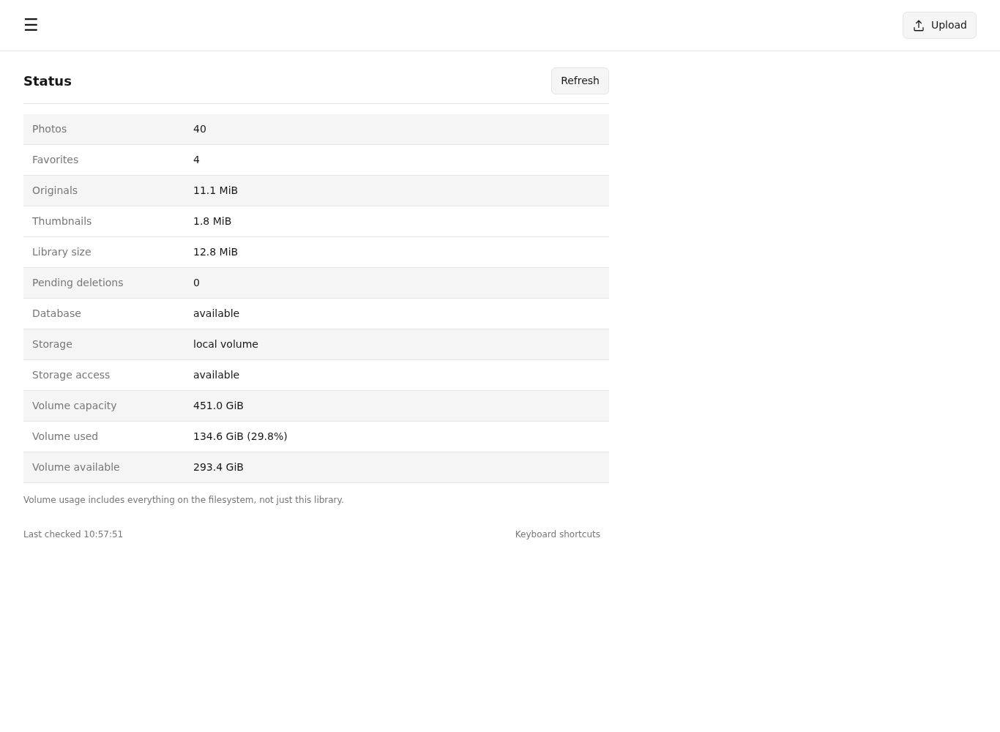

# Lumio

A self-hosted photo and video library written in Go. Lumio uses PostgreSQL for metadata and supports local storage, persistent volumes, and cloud buckets.

## Screenshots

Light theme with upload-date navigation:



Dark theme with photo selection:



Video playback:



Storage and library status:



[Demo image and video sources](docs/screenshots/SOURCES.md).

## Features

- Photo and video uploads, JPEG thumbnails, favorites, filename search, and original downloads.
- MP4 and WebM playback with duration badges and seeking.
- Selection by photo, video, day, mouse drag, or Ctrl/⌘+A across the current search and date filters, up to 1000 files.
- Download selected originals as a streaming ZIP, or delete the selection with confirmation.
- Upload timeline with year/month navigation, date filtering, and automatic loading while scrolling.
- Simple interface with light, dark, and system themes.
- SHA-256 deduplication and unchanged original files.
- Password authentication with sessions shared across replicas.
- Local files, S3-compatible buckets, Google Cloud Storage, and Azure Blob Storage.
- Disk usage, library statistics, and storage availability in the status panel.
- JSON logs, health endpoints, and Kubernetes manifests.

Images support JPEG, PNG, GIF, and HEIC up to 40 megapixels. HEIC originals are preserved, with JPEG thumbnails and previews for browser display. Videos support MP4 with H.264 video and optional AAC audio, or WebM with VP8/VP9/AV1 video and optional Opus/Vorbis audio. Playback depends on browser codec support; originals are preserved without transcoding.

The default per-file upload limit is 32 MiB for both photos and videos, configurable up to 256 MiB. The timeline uses upload dates.

Lumio ships as a single binary with an embedded web interface. Video processing requires `ffmpeg` and `ffprobe` on the server PATH; container images include both.

## Quick start

Requires Docker, Docker Compose, and Make.

```sh
cp .env.example .env
# Set LUMIO_PASSWORD in .env to a password of at least 16 characters.
make dev
```

Open <http://localhost:8080> and sign in with the configured password. Compose starts the app and PostgreSQL, with named volumes for the database and photos.

```sh
docker compose logs -f app
docker compose down
```

Stopping the services preserves their volumes. `docker compose down -v` deletes the development data.

## CLI and Android

The separate `lumio-cli` binary supports login, uploads, downloads, listing,
favorites, deletion, and status. `make build` builds the server and client;
release archives include both. Run `lumio-cli help` or see the [CLI guide](docs/cli.md).
The native [Android app](android/README.md) follows the web library design, with
a photo grid, timeline, search, favorites, native viewers, original/ZIP downloads,
and a persistent upload queue.
Build an installable APK with `make android-apk`.

The backend separates its core use cases from PostgreSQL, object storage, and
media processing through ports. See [architecture and the twelve-factor deployment
contract](docs/architecture.md).

## Configuration

All application configuration is provided through environment variables.

| Variable | Default | Description |
| --- | --- | --- |
| `DATABASE_URL` | required | PostgreSQL connection URL |
| `LUMIO_PASSWORD` | required | Login password; at least 16 characters |
| `LUMIO_AUTO_MIGRATE` | `true` | Initialize schema at startup; set `false` after running `lumio migrate` separately |
| `LUMIO_MAINTENANCE` | `true` | Run cleanup in the web process; set `false` when using a dedicated `lumio worker` |
| `LUMIO_ADDR` | `:8080` | HTTP listen address |
| `LUMIO_STORAGE_URL` | local directory | Storage backend URL |
| `LUMIO_DATA_DIR` | `data` | Local directory when the storage URL is unset |
| `LUMIO_SECURE_COOKIE` | `true` | HTTPS-only cookies; use `false` for local HTTP |
| `LUMIO_MAX_UPLOAD_MB` | `32` | Per-file upload limit in MiB, from 1 to 256 |
| `LUMIO_MIGRATE_TO` | unset | Destination URL for storage migration |

Storage URLs use `file:///data`, `s3://bucket?region=us-east-1`, `gs://bucket`, or `azblob://container`. Credentials follow the selected provider's environment variables or default credential chain. See the [storage guide](docs/storage.md) for configuration, migration, and backup instructions.

## Deployment

Kustomize overlays support a single replica with a PVC or multiple replicas sharing a bucket and PostgreSQL database. See the [Kubernetes deployment guide](docs/deployment.md).

Version-tagged container images are published to `ghcr.io/yyvfuruta/lumio:<tag>` by the release workflow.

## Development

Use the Go version declared in [go.mod](go.mod).

```sh
make test
go vet ./...
make build
```

CI runs integration tests with PostgreSQL and Garage. Release tags trigger GitHub Actions to build binaries and multi-platform container images. See [development and releases](docs/development.md) and the [HTTP API reference](docs/api.md).

## License

[GNU GPL v3](LICENSE).
