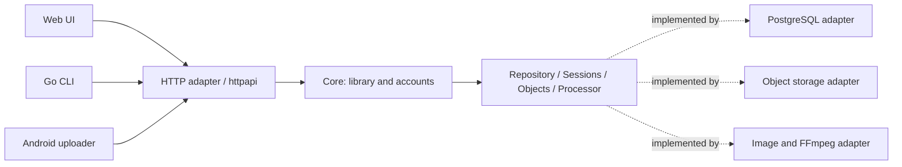

# Architecture and operating contract

Lumio uses a hexagonal structure: the core owns entities, business rules, and
outbound interfaces. Infrastructure implements those interfaces, and delivery
adapters call the core. The web interface, CLI, and Android app use one HTTP API.

| Package | Responsibility |
| --- | --- |
| `internal/core` | Photos, filters, pagination, import orchestration, favorites, deletion, archives, accounts, and outbound ports; standard library only |
| `internal/adapters/postgres` | Queries, schema, sessions, expiration, transactions, advisory locks, migration guards, and readiness |
| `internal/adapters/objectstore` | Local/S3/GCS/Azure objects, range reads, configuration validation, and idempotent object removal |
| `internal/adapters/media` | Image decoding, HEIC previews, thumbnails, video validation, and bounded FFmpeg/FFprobe execution |
| `internal/adapters/maintenance` | Administrative storage migration and byte/hash verification |
| `internal/adapters/httpapi` | HTTP routing/representations, browser security, embedded web UI, and streaming media/ZIP delivery |
| `internal/app` | Composition, environment configuration, and worker lifecycle |
| `cmd/lumio-cli` | Separate client executable; no backend/codec dependencies |
| `internal/cli` | Remote client, local session persistence, output formatting, and streaming file transfer; standard library only |
| `android` | Android UI, upload queue, encrypted session storage, and HTTP transport |

Interfaces belong to their consumer (`core`), not their implementation. Neither
HTTP types, SQL, pgx, cloud bucket types, nor codec libraries enter the core.
HTTP maps core input/not-found/authentication failures to status codes, and hides
unexpected infrastructure errors. Transport links live in HTTP representations,
not in entities. Composition in `app.New` is the place that selects adapters.

Import coordination is deliberately part of the repository contract: a
transaction holds the per-photo lock and shared storage-configuration lock while
the core writes objects, then commits metadata. A duplicate skips object writes.
Object failure prevents metadata commit. Collection uses the same locks and
rechecks tombstones. Migration holds an exclusive configuration lock. Do not
split these steps into unrelated repository calls: that would introduce races
between replicas. Object writes are not a distributed transaction; an interrupted
import may leave unreferenced objects, as before. Retrying the same content is safe.

Temporary upload spools exist only during one use case, are bounded by the upload
limit, and are removed on return. They are not a persistent filesystem queue.
The media port receives their local path because FFmpeg consumes seekable files.

## Twelve-factor deployment

The [12-factor methodology](https://12factor.net/) applies to the server's
execution and deployment, not to the CLI's local preferences or Android's user
settings. The repository supplies these mechanisms; the deployment must supply
the corresponding operational guarantees.

| Factor | Implementation / deployment requirement |
| --- | --- |
| I. Codebase | One versioned repository; deploy the same release to each environment. |
| II. Dependencies | Go modules/checksums, explicit runtime video tools in the image, Android SDK versions pinned in the build script. |
| III. Config | Independent environment variables; no environment-specific config is compiled into the server. Inject secrets at runtime. |
| IV. Backing services | PostgreSQL and object storage are selected by URLs. Use a shared bucket for horizontally scaled replicas. |
| V. Build/release/run | Build binaries/images in CI, inject config when running, and deploy immutable version tags/digests. |
| VI. Processes | No process-local persistent sessions or metadata. Store originals in a bucket/attached storage service. Local volume mode requires explicitly durable mounts and is intended for a single replica. |
| VII. Port binding | The server owns its HTTP listener via `LUMIO_ADDR`. TLS may terminate at the ingress. |
| VIII. Concurrency | Scale web and maintenance process types separately using `serve` and `worker`; set `LUMIO_MAINTENANCE=false` on web processes when running dedicated workers. |
| IX. Disposability | SIGINT/SIGTERM cancel requests/workers and allow HTTP shutdown for up to 30 seconds. Configure a sufficient supervisor termination grace period. |
| X. Dev/prod parity | Use the same Go version, PostgreSQL, API, and storage contracts. CI exercises PostgreSQL and S3-compatible storage. |
| XI. Logs | JSON events go to standard streams; the runtime collects/routes them. No application-managed log files. CLI data stays on stdout and errors go to stderr. |
| XII. Admin processes | `migrate` and `migrate-storage` execute from the same release with runtime config. Back up data before administrative changes. |

`lumio serve` (or no subcommand) starts web and maintenance together by default
for existing single-process installations. A separate `lumio worker` runs cleanup
without opening a port. Multiple workers coordinate through PostgreSQL and may
be restarted safely. Every process must share the same database, password, and
storage URL. Schema initialization remains idempotent at startup for compatibility.
For separate release/run phases, execute `lumio migrate` with a schema-owner role,
then set `LUMIO_AUTO_MIGRATE=false` on web and worker processes using a runtime
role with only the required table/sequence permissions. They verify the registered
storage configuration without running DDL. A fresh database needs the explicit
administrative migration before starting these processes.

Strict compliance cannot be guaranteed by source code alone: using an ephemeral
local directory for originals, deploying mutable images, storing production secrets
in files under source control, or failing to route logs violates this contract.

## HTTP resource contract

The API follows the [HTTP semantics in RFC 9110](https://www.rfc-editor.org/rfc/rfc9110.html)
and REST's [uniform interface and hypermedia constraints](https://ics.uci.edu/~fielding/pubs/dissertation/rest_arch_style.htm).
`GET /api/v1` is a discoverable entry point. Photo representations expose related
resource links and allowed mutation methods. Collection pagination exposes the
next relation in the body and an HTTP `Link` header, preserving all filters.

Resources use nouns; GET/HEAD are read-only, POST creates resources, PATCH updates
favorites, and DELETE removes the resource association. Creation returns 201 and
Location; content deduplication returns the existing resource with 200. DELETE's
state effect is idempotent: repeating it may return 404 after the first 204.
Private responses use explicit `Cache-Control: no-store`; originals retain byte
range/HEAD semantics. Browser, CLI, and Android all authenticate with the same
revocable credential resource, transmitted with every protected request. No
sticky replica or in-memory workflow state is required. Session records contain
credential hashes and expiration, never a client's navigation state.

Compatibility fields (`photo`, `photos`, `duplicate`, `nextCursor`, archive `url`)
are retained. New `links` fields are additive. This API deliberately keeps the
existing `photos` resource name for both photos and videos, avoiding a breaking
rename to `media`. See [API details](api.md).
